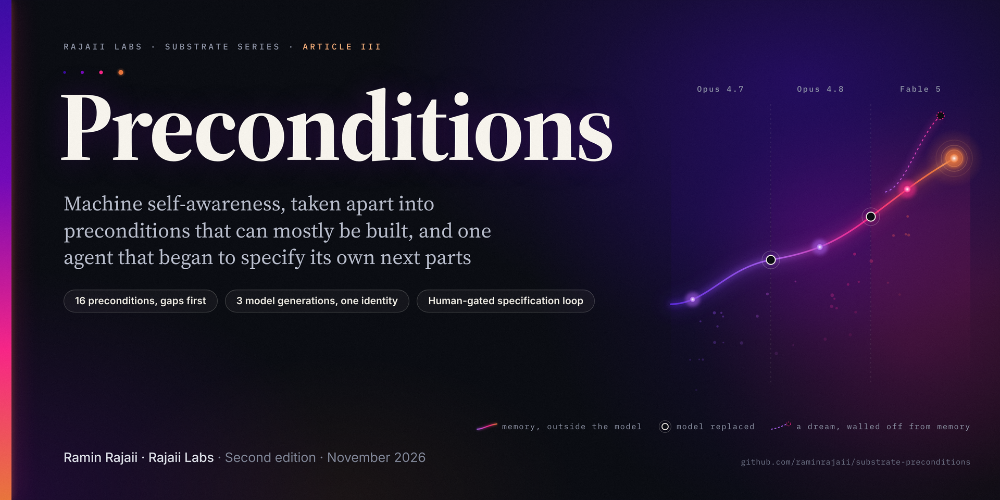

# Preconditions



**Machine self-awareness, taken apart into preconditions that can mostly be built, and one agent that began to specify its own next parts.**

Rajaii Labs · Substrate Series · Article III · November 2026

Second edition, November 2026; the first edition is kept exactly in [`archive/first-edition/`](./archive/first-edition/).

Whether a machine could be aware of itself is usually argued as one question nobody can answer. This paper takes it apart into sixteen preconditions, the properties a system needs before a claim about its self-awareness can be tested, most of which can be built and checked, and grades one agent, Substrate, against them, starting with what it lacks. Substrate is a production AI agent built on Claude that I have run for one user, me, since April 2026; its memory, its record of facts and its standing instructions live outside the model, so the model can be replaced and the agent stays. By the 2026-08-14 snapshot it had seven of the sixteen and four more in part, four were missing, and the sixteenth, experience itself, is beyond any instrument; its model was replaced twice, and its memory, records and instructions carried across intact. Once enough of the list existed, it began, when asked, to write the specifications for its own next parts, and they shipped through my review.

**[Read the PDF](https://raminrajaii.github.io/substrate-preconditions/Substrate_Preconditions.pdf)** · **[Read the full text (Markdown)](./Substrate_Preconditions.md)** · **[The first edition](./archive/first-edition/Substrate_Preconditions.md)**

**The Substrate series:** [Article I](https://github.com/rajaii-labs/agent-eval-methodology) · [Article II](https://github.com/rajaii-labs/agent-cost-forensics) · Article III, this paper · [Article IV](https://github.com/raminrajaii/substrate-choices) · [Article V](https://github.com/raminrajaii/substrate-recursion)\
**How to cite:** Rajaii, R. (2026). *Preconditions* (2nd ed.). Rajaii Labs, Substrate series, Article III. [BibTeX](#citation) · [CITATION.cff](./CITATION.cff)

---

## What is in the paper

**The story**, sections 1–7, about 7,000 words:

- **The opening.** The dream engine of 2026-08-12, the main point in a minute, and the three observations from the first edition's own table that would prove its findings wrong.
- **1. The argument about machine minds is stuck, and products are building its parts anyway.** The two camps, the indicator method, the parts accumulating for product reasons, and self-improvement arriving as a specification.
- **2. Substrate keeps one identity outside a rented model, and I am the person most likely to over-read it.** What Substrate is, the system measured on one day, and the series.
- **3. Taken apart, the question has sixteen parts, and this system had seven of them and part of four more.** The list, gaps first (Figure 1), and a tour of what is built; 3.1, the dream firewall (Figure 2).
- **4. Its model was replaced twice, and the identity stayed in the stores.** Three model generations over one unbroken record (Figure 3), and what that does and does not show.
- **5. Once enough of the list existed, it began, when asked, to write the specifications for its own next parts, and they shipped.** The ladder, the specification that warned against its own author, and the four human functions that remain.
- **6. It makes the question testable without answering it, and a test read by a rule fixed in advance overruled me.** The four conditions, the test fixed in advance, moral status and the sealed interior.
- **7. Of fourteen claims, none is refuted: two held, five hold only within limits printed beside them, and seven remain open.** Every claim beside what would refute it, and a table of what Articles IV and V found since.

**Technical sections**, T1–T17: the system measured, its context and its stores, each precondition in full, the threshold and the indicators, the ladder rung by rung, the four functions, the Dream Engine, the experiments, the implications at full strength, what would falsify this, open problems, the corrections the first edition made to Articles I and II, the lessons, what changed in this edition with a map of every first-edition section, and the glossary.

**Beside the paper.** The figures, as SVG and PNG, in [`figures/`](./figures/); the first edition, exactly as published, in [`archive/first-edition/`](./archive/first-edition/) and at the tag [`first-edition`](https://github.com/raminrajaii/substrate-preconditions/tree/first-edition).

## The Substrate series

1. **Recall, Negation, Abstention** — Rajaii Labs, July 2026 · second edition, November 2026. [Repository](https://github.com/rajaii-labs/agent-eval-methodology)
2. **Do Not Trust My Labels** — Rajaii Labs, July 2026 · second edition, November 2026. [Repository](https://github.com/rajaii-labs/agent-cost-forensics)
3. **Preconditions** — Rajaii Labs, August 2026 · second edition, November 2026. *This paper.*
4. **Choices** — Rajaii Labs, October 2026 · second edition, November 2026. [Repository](https://github.com/raminrajaii/substrate-choices)
5. **Recursion** — Rajaii Labs, November 2026. [Repository](https://github.com/raminrajaii/substrate-recursion)

## Citation

```bibtex
@techreport{rajaii2026preconditions,
  author      = {Rajaii, Ramin},
  title       = {Preconditions: Machine self-awareness, taken apart into preconditions that can mostly be built, and one agent that began to specify its own next parts.},
  institution = {Rajaii Labs},
  year        = {2026},
  month       = nov,
  edition     = {Second},
  note        = {Substrate series, Article III. First published August 2026}
}
```

The same metadata is in [`CITATION.cff`](./CITATION.cff), which GitHub's "Cite this repository" reads.

## Contact

Substrate is a production system of Rajaii Labs, built on Claude. Architecture and methodology questions welcome: **ramin@raminrajaii.com** · [linkedin.com/in/raminrajaii1](https://www.linkedin.com/in/raminrajaii1) · ORCID [0009-0009-5517-6701](https://orcid.org/0009-0009-5517-6701)

© 2026 Ramin Rajaii. All rights reserved. Terms of use: [LICENSE.md](./LICENSE.md).
