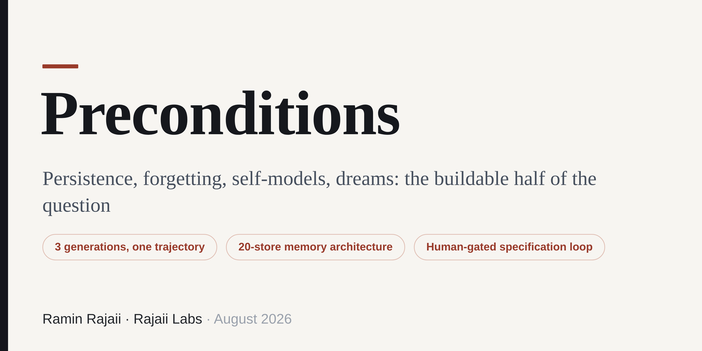

# Preconditions



**Persistence, forgetting, self-models, dreams: the buildable half of the question**

Rajaii Labs · Substrate Series · Article III · August 2026

**[Read the PDF](./Substrate_Preconditions.pdf)** · **[Read the full text (Markdown)](./Substrate_Preconditions.md)**

---

## In one paragraph

Machine self-awareness is debated as if it were a single untestable threshold. It is not: it decomposes into a list of architectural preconditions — persistence, autobiographical memory with a truth-status type system, forgetting, a self-model the system queries rather than recalls, a gradeable model of someone else, endogenous activity, recombination that cannot be mistaken for memory — and every item on the list is buildable. This paper grades a production system against that list, gaps first: Substrate, a single-principal deployment running since 2026-04-23, with 17,373 persisted turns, roughly twenty memory stores, ~137,500 characters of governed context per turn, and three frontier model generations survived with identity intact. The finding that matters is downstream of the list: once enough of it existed, the system began specifying its own architecture — and its specifications shipped, with acceptance criteria, negative tests, and guards against its own unreliability, leaving the human performing four functions: transport, implementation, review, and the gate. What exists is named exactly — a human-gated recursive specification loop, closed at the specification layer, open at execution, evaluation, and deployment. The paper's claim is deliberately narrow and deliberately unsettling: the qualitative shape of a self-improvement loop is present, the quantitative scale is trivial, and the gap between those two statements is engineering rather than science.

## Abstract

*`status TEXT NOT NULL CHECK (status IN ('HAPPENED','PLANNED','RIFF'))` — and no default.* That column sits in the episodic memory of a production system, and the missing default is a philosophical decision enforced by the database: a memory writer that stays silent about whether an event happened, was planned, or was invented does not get a value filled in on its behalf, because **a default records the writer's silence as an assertion.** This paper is about a system built out of decisions like that one, and about what those decisions add up to.

The system is Substrate: a single-principal deployment in production since 2026-04-23 — 17,373 persisted conversational turns, roughly twenty distinct memory stores, ~137,500 characters of assembled context per turn, fourteen scheduled jobs, three frontier model generations survived with identity and memory intact, a background worker on separate infrastructure that wakes on its own timer and runs a full cognition pass when nobody is talking to it, and, since 2026-08-12, a recombination layer — a dream engine — whose entire design problem was making it structurally impossible for the system's imagination to contaminate its memory.

The argument: machine self-awareness is debated as if it were one untestable threshold. It is not. It decomposes into a list of architectural preconditions — persistence, autobiographical memory with a truth-status type system, forgetting, a self-model the system queries rather than recalls, a gradeable model of someone else, endogenous activity, recombination without confabulation — and every item on the list is buildable. This system has built most of them. The gaps are named first.

But the finding that matters is downstream of the list: **once enough of the list existed, the system began specifying its own architecture** — reading its own schema, diagnosing its own deficits, writing build specifications that carry scope, constraints, acceptance criteria, negative tests, and guards against its author's own unreliability. Those specifications shipped. On those builds the human role reduced to four functions: transport, implementation, review, and the gate. Each is a piece of engineering, not a law of nature.

Boundary of the claim: this paper concerns functional and access properties only. Phenomenal experience is untouched — unverifiable from the outside for any system, this one included. The evidence is N=1, and the operator of a long-running single-principal system is exactly the person with the strongest incentive to over-read it. Including here. What the architecture buys is not a verdict but a venue: these are the conditions under which the other-minds question stops being a contest between projection and denial and becomes an empirical research program.

## What is in the paper

- **Part I — The machine that is already running.** The measured object: the per-turn context assembly and why cache position is a semantic property; the twenty-store memory census; honesty by lookup; five production findings on continuity, placeholders, supersession, recoverability budgeting, and the incentive gradient.
- **Part II — The preconditions.** A shipped-or-not verdict table against the accounts of mind that motivate each precondition — led by what is missing — then each discharged in turn: persistence vs. search, substrate independence, episodic memory with receipts, forgetting, the four properties of an operational self-model and the three ablations that would test it, the written interior, the sealed theory-of-mind store, prediction error, endogenous activity, embodiment, and where the global-workspace and recurrence analogies break. Closes on the empirical threshold — the four conditions under which the question becomes live — and the indicator-property literature's hinge.
- **Part III — The loop that closed.** A seven-rung ladder from self-visibility to a shipped, self-authored build specification; the four human functions that remain and the three stronger recursions that are absent; the counterweight, at equal force; the Dream Engine — recombination behind a schema boundary and a build gate, including the silent-catch bug that hid half of it; and a preregistration-style table of ten experiments the instrumentation now supports, most deliberately reported as unrun.
- **Part IV — What this means.** Fenced extrapolation, every claim anchored to a shipped mechanism and a named increment: preconditions built by accident, why recursive self-improvement is boring before it is dramatic, trajectories vs. functions, self-models as the fastest-moving precondition, what we would need in order to tell, moral status under deep uncertainty, and the open question the sealed interior creates.
- **Back matter.** Six falsification conditions with status markers; open problems and what is not built; a corrections table against Articles I and II; fourteen transferable lessons; verified references.

## The Substrate series

1. **Recall, Negation, Abstention: Evaluating a Production LLM Agent Against Its Own Failure Modes** — Rajaii Labs, July 2026. A field methodology for hallucination, contradiction, and drift detection in memory-augmented agents.
2. **Do Not Trust My Labels** — Rajaii Labs, July 2026. Granting autonomy to a production LLM agent, the specification it wrote for its own interior, and five silent defects found by following the money.
3. **Preconditions** — Rajaii Labs, August 2026. *This paper.*

## Citation

This repository includes a [`CITATION.cff`](./CITATION.cff); GitHub's "Cite this repository" button will format it for you. BibTeX:

```bibtex
@techreport{rajaii2026preconditions,
  author      = {Rajaii, Ramin},
  title       = {Preconditions: Persistence, forgetting, self-models, dreams --- the buildable half of the question},
  institution = {Rajaii Labs},
  year        = {2026},
  month       = aug,
  note        = {Substrate series, Article III}
}
```

## Contact

Substrate is a production system of Rajaii Labs, built on Claude. Architecture and methodology questions welcome: **ramin@raminrajaii.com** · [linkedin.com/in/raminrajaii1](https://www.linkedin.com/in/raminrajaii1) · ORCID [0009-0009-5517-6701](https://orcid.org/0009-0009-5517-6701)

© 2026 Ramin Rajaii. All rights reserved.
